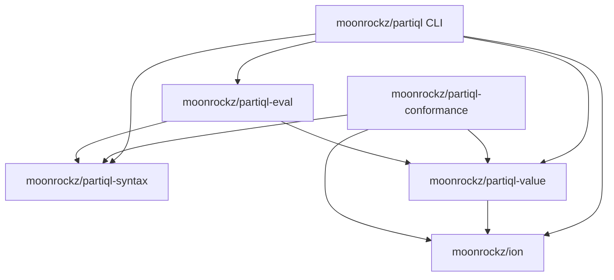

# Architecture

## Overview

This repository is one MoonBit workspace (`moon.work`) with several modules
under `modules/`. Each module is published to mooncakes.io on its own, with
one shared version (see [ADR 0002](adr/0002-lockstep-versioning.md)).

Module boundaries follow two questions:

- Who uses the code? A linter or a transpiler needs the parser but not the
  evaluator. A data tool needs the data model but not the parser.
- What does the code depend on? The data model depends on `moonrockz/ion`. The
  parser does not.

A package import path is the module name plus the package path. If a package
moves to a different module, every user breaks. Thus the module boundaries are
fixed from the start (see [ADR 0001](adr/0001-workspace-monorepo.md)).

## Module map

| Module | Packages | Depends on | Targets | Published |
|---|---|---|---|---|
| `moonrockz/partiql-value` | root (`Value`), `ion`, `json` and `yaml` (codecs), `arbitrary` (generators) | `moonrockz/ion` | wasm, wasm-gc, js, native | yes |
| `moonrockz/partiql-syntax` | root (`parse`), `ast`, `lexer`, `parser` | `moonrockz/ion` | wasm, wasm-gc, js, native | yes |
| `moonrockz/partiql-eval` | root (`evaluate`), `plan`, `lower`, `ops`, `interp` | value, syntax, `moonrockz/ion` | wasm, wasm-gc, js, native | yes |
| `moonrockz/partiql` | root (executable), `cli` | value, syntax, eval, `moonrockz/ion`, `moonbitlang/x`, `moonbitlang/async` | native, wasm | yes |
| `moonrockz/partiql-conformance` | root (test-only) | value, syntax, `moonrockz/ion`, `moonbitlang/x` | native, js | no |

The `partiql` module has the CLI as its root package, so
`moonx moonrockz/partiql` runs the tool. The `cli` package holds the command
logic; the root package only prints and exits.

## Dependency graph

## Package plan

- `partiql-value`
  - root: `Value`, the PartiQL data model: absent values, numbers, text,
    LOBs, `Date`/`Time`/`Timestamp`, intervals, `List`, `Bag`, `Tuple`, and
    `Map` (RFC 0104: `MapValue` with declared `MapType`s), `Graph` (RFC 0025:
    `GraphValue` with id-keyed nodes and edges), and `Ion` (boxed exact Ion,
    ADR 0005). Relations: structural `Eq`,
    `sql_equals` (the `=` operator), `eqg` (grouping) and `compare` (ORDER
    BY). One concern per file (`value.mbt`, `tuple.mbt`, `bag.mbt`,
    `datetime.mbt`, `interval.mbt`, `map.mbt`, `graph.mbt`, `numeric.mbt`,
    `text.mbt`,
    `identity.mbt`, `lower.mbt`, `equality.mbt`, `ordering.mbt`). Value
    operations use explicit work stacks, so values built at runtime can be
    deeper than the parser's nesting limit. `equivalence.mbt` handles
    structural and grouping equality, including one-to-one matching of
    unordered collections. `equivalent_by` lets evaluation supply its
    datetime and absent-value rules. Ordering canonicalizes children from
    leaves to root before sorting, then compares with a work stack, so sort
    callbacks do not recurse through values. `traversal.mbt` provides
    `Value::fold` for deep lowering, encoding and debug representations.
  - `ion`: the Ion codec in two modes: PartiQL-encoded (`from_ion`,
    `to_ion`, for partiql-tests data) and Ion-preserving (`from_ion_data`,
    `to_ion_data`, for Ion data; ADR 0005). Its default
    alias is `ion`, so it imports `moonrockz/ion/ion` as `@ion_core`.
    Consumers import it as `@partiql_ion`. Both encoding and decoding use
    work stacks, including map values and graph payloads; boxed Ion remains
    exact in both modes. `read_text`/`read_bytes` and `write_text`/`write_bytes`
    handle complete PartiQL-encoded datagrams. Byte input detects binary Ion
    by its version marker, otherwise requiring UTF-8. Optional Ion Schema
    validation checks raw values or a whole document before decoding.
    `IonDataError` retains transport, codec and schema errors, including all
    violation paths. See ADR 0007.
  - `json`: strict single-document UTF-8 JSON input/output. Numbers retain
    integer precision or decimal scale, and tuples retain duplicate fields.
    Unsupported PartiQL kinds raise typed errors. `Bindings::from_json_text`
    and `from_json_bytes` load environments; the CLI selects JSON explicitly.
  - `arbitrary`: quickcheck generators (`gen_value`, `ArbValue`, ...) and
    the property laws of the data model. Published so that later milestones
    can reuse the generators.
- `partiql-syntax`
  - root: `parse(String) -> Statement raise ParseError`, `parse_script`,
    `parse_script_recovering(String) -> Recovered`, `print`, `print_script`
    and `format(String, width?) -> String raise ParseError`
    (re-exports `Statement`, `Script`, `Comment`, `ParseError`, `Span` and
    `Recovered` from `ast`).
  - `ast`: the syntax tree (Kotlin v1 style, one node per form, every node
    with a `Span` of UTF-16 offsets), `Span` and `ParseError` (`Syntax` with
    message, span, expected tokens and the found token; `Unsupported`),
    `Script` and `Comment`, `Recovered` (a partial script and its errors),
    the `Error` nodes of recovered trees (`ExprKind::Error`,
    `Statement::Error`), and `strip_spans` (structural equality).
  - `lexer`: tokens; keywords are words that the parser classifies;
    punctuation is one character per token and the parser composes `<<`,
    `<=`, `||` and similar operators from touching tokens; Ion literals are
    scanned Ion-aware and checked with the stack-safe Ion text reader, which
    has no default container nesting limit. `lex_recovering`
    records every lexical error and marks broken literals as `Invalid`
    tokens.
  - `parser`: recursive descent with a precedence ladder for expressions
    (OR, AND, NOT, IS TRUE/FALSE/UNKNOWN, predicates, `||`, `+ -`,
    `* / %`, signs, path steps), special forms by name, a reserved-word table
    (the Kotlin grammar's, without the datetime field words), and a nesting
    limit of 100 levels: deeper input is a `Syntax` error ("nesting is too
    deep"). The limit protects the call stack. Without it, debug builds
    overflow at these depths (measured 2026-10-01): nested queries
    (`(SELECT VALUE …)`) near 100 on wasm and near 200 on wasm-gc and js;
    nested parentheses near 150 on wasm, 300 on js and 500 on wasm-gc;
    native passed 500 of both. `parse_script_recovering` recovers from
    errors (`recover.mbt`): recovery points at statements, clauses and list
    items catch an error, record it, skip to a synchronizing token and
    return an `Error` node; trial parses and graph patterns run strict.
    Graph
    MATCH (GPML) is in `graph.mbt`.
  - `diagnostic`: `render(ParseError, source, name~, color?)` (rustc-style
    diagnostics) and `position` (1-based line, column in code points).
  - `sexp`: `to_sexp` and `expr_to_sexp`, the public S-expression format,
    laid out with `moonrockz/pretty`; deep chains are built with loops.
  - `printer`: syntax tree to text. It builds a document (Wadler-style
    algebra with groups and nests) and renders it flat for the canonical
    form, or through `moonrockz/pretty` at a width for the pretty layout;
    comments from the source are written at the nearest node boundary.
    Depends on `ast` and `moonrockz/pretty`.
- `partiql-eval`
  - root: `evaluate(Statement, env~, mode?) -> Value raise EvalError`,
    `evaluate_text(String, env~, mode?)`, `Bindings` (the global
    variables: `empty`, `of_tuple`, `of_ion`, `from_ion_text`, `from_ion_bytes`,
    `with_data`), and the re-exports `Mode` (`Permissive` or `Strict`) and
    `EvalError`. `Session` bundles bindings, mode, zone and clock for repeated
    evaluation, scripts, element-wise datagrams and text/binary Ion output.
  - `plan`: the logical plan, `Mode` and `EvalError` (`TypeError`,
    `DataError`, `Unsupported`, `Syntax`). `Expr` and `Step` are scalar
    expressions and path steps. `Rel` is the relational part, close to the
    binding-tuple algebra: `Scan` (with AT), `Unpivot`, `Filter` (WHERE),
    `Join` (`JoinKind`: cross, inner, left, right) and `Let`. An `Expr`
    holds a query block with a `Rel` and a `Projection` (`Value`, `Items`,
    `Star`, `Pivot`), and a subquery with a `SubqueryUse` (`Scalar`,
    `Column` or `Row`). Three more `Expr` nodes cover the rest of a query:
    `Query` (a body with ORDER BY keys, LIMIT and OFFSET), `SetOp` (UNION,
    INTERSECT and EXCEPT with their flags) and `With` (named bindings and a
    body). ADR 0006 has the rationale.
  - `lower`: syntax tree to plan. It desugars the surface forms, converts
    literals (numbers, datetimes, intervals, Ion) to values, and raises
    `Unsupported` with a span for a form that is not evaluated yet, or for
    a type parameter that `IS` does not check. `query.mbt` lowers a query
    block and resolves names: a name is a local (FROM, AT or LET variable),
    an attribute of an in-scope query variable, or a global binding, in that
    order. A FROM source expression finds a global before a FROM
    variable. An unbound name with query variables in scope (FROM AS and AT,
    and LET) resolves first as the attribute of the first in-scope variable
    tuple that has it (innermost query first, in declared order), then as a
    global; found nowhere it is MISSING in permissive mode and a `TypeError` in
    strict mode. With no FROM variable in scope it lowers to a global, and
    the undefined-variable `DataError` is raised at run time in both modes.
    A variable name that a FROM clause declares twice (AS, AT or an implicit
    name) is a `DataError` that suggests `AS`; names compare exactly, and a
    LET variable or an inner query may shadow an outer name.
    `Query` wraps a body (a SELECT block, PIVOT, a set operation, `TABLE` or
    any expression) when the query has ORDER BY, LIMIT or OFFSET. Sort keys
    are lowered in a scope where the output names are exact-name variables
    (they are not candidates for implicit lookup). A key that is exactly a
    name finds an output name first; in any other key expression a FROM, LET
    or outer variable wins, and an output name is visible when no variable
    has that name. For a body that is not a SELECT block, each output element is
    bound to a hidden variable that no identifier can name, so a plain name
    in a key is an attribute of the output element. A set-operation chain is
    lowered in a loop along its left spine. `TABLE a.b` lowers as
    `SELECT * FROM a.b`. `WITH` lowers its bindings in order in a scope of
    the earlier names; a WITH name hides a global everywhere and is not a
    candidate for implicit lookup (a scope kind, not a FROM variable). A
    SELECT subquery compared with a list, row or s-expression literal lowers
    to `SubqueryUse::Row`. A negative integer literal in LIMIT or OFFSET is a
    `DataError` at lowering.
    `depth.mbt` is the depth guard:
    it charges each part of a plan with the stack it uses when it runs and
    refuses a plan above 200 levels with a `DataError`, so the evaluator
    does not overflow the stack. Chains of binary operators, AND and OR
    are lowered in a loop. Literal values cost one level regardless of data
    nesting: Ion 0.6.0 readers and value operations are stack-safe and have
    no default data nesting limit. The expression-depth guard still applies
    to the plan that the interpreter executes.
  - `ops`: the semantics of each operator as pure functions on values:
    numeric and decimal arithmetic, comparison, three-valued logic, LIKE,
    datetime and interval arithmetic, type tests and path steps. `=`
    compares the elements of collections with its own datetime rule, and
    IN uses `=`.
  - `interp`: walks the plan with a `Ctx` (the global bindings, the `Mode`
    and the error of a relation's iterator) and applies `ops`. Operator
    chains run in a loop. A binding tuple is an `Env`: a chain of frames,
    innermost first, where each frame points to its outer frame. A
    correlated subquery reads the outer row without a copy. A relation
    (`Rel`) streams its rows as an `Iter[Env]` (`relation.mbt`): scans and
    joins produce rows on demand, and a join keeps rows in an array only for
    a right join. The `Iter` of the core library cannot raise, so `rows`
    keeps the first error in the `Ctx` and ends the iteration, and `pull`
    and `each` raise it after the last good row.
    - `relation.mbt` also has `select_pairs`: a query block yields
      (binding tuple, projected value) pairs, so ORDER BY can read the row
      that made each value. Without ORDER BY, a SELECT reads its source
      lazily (`select_pairs_upto`) and stops after the rows that LIMIT and
      OFFSET need; DISTINCT
      dedupes while it streams.
    - `order.mbt` runs `Query`. It evaluates LIMIT and OFFSET once, in the
      outer binding tuple. A value that is not an integer of 0 or more is
      ignored in permissive mode and a `TypeError` in strict mode. Sorting
      evaluates the keys once per row, then sorts an array of indices by the
      key comparison (ASC `compare(a, b, nulls)`, DESC the reversal with
      flipped NULLS) and, on a tie, by the input position, so the sort is
      stable. ASC puts NULL and MISSING last and DESC puts them first, unless
      NULLS FIRST or LAST says otherwise. A key that fails is a `TypeError`
      in strict mode and sorts as MISSING in permissive mode. The result is
      a list; without ORDER BY it is a bag. PIVOT joins the row tuples into
      one tuple after the rows are sorted and windowed.
    - `setop.mbt` runs `SetOp`. The interpreter collects the steps of a
      left-spine chain in a loop. Equality is `eqg`, through a `Counter`
      that keeps values in buckets by `group_key` (DISTINCT uses the same
      `Counter`). The result is a bag: left elements, then right elements.
      SQL operations are positional: each operand must be a list or bag of
      tuples, every tuple takes the reference names by position, and a
      degree or column-type mismatch is a `DataError`. OUTER operations take
      any operand: a collection gives its elements, NULL and MISSING give
      the empty bag, and another value is a one-element bag (a `TypeError`
      in strict mode). CORRESPONDING keeps the shared or named attributes.
    - Array coercion: `SubqueryUse::Row` gives NULL for no row, the list of
      the attribute values for one row, and MISSING (permissive) or a
      `TypeError` (strict) for more.
    - Materializing nodes: sorting, set operations and DISTINCT hold their
      input in memory. Everything else streams (ADR 0006).
- `partiql`
  - root: the executable.
  - `cli`: `run(args, io?) -> Outcome`, with the commands `parse`, `check`,
    `format`, `query`, `version` and `help`, and the global `--color`. Errors
    print as rendered diagnostics (`@syntax.render`, and
    `@syntax.render_message` for evaluation errors). `query` evaluates with
    `partiql-eval` and reads and writes PartiQL-encoded Ion in text or binary.
    `--each` runs the script per top-level data element; schema options validate
    every input before evaluation. `Outcome.stdout_bytes` carries raw binary
    output. File and stdin access comes in through the `Io` record, including
    optional byte readers, which `main.mbt` provides
    (`moonbitlang/x/fs` and `moonbitlang/async` stdin). See the CLI section of `AGENTS.md`.

## Rules

- Never move a package between modules.
- Library modules build and pass their tests on wasm, wasm-gc, js and native.
- Library code may use the base class library (`moonbitlang/core`,
  `moonbitlang/x`, `moonbitlang/async`) and `moonrockz/ion`. A
  target-restricted dependency needs `supported_targets` and a reason.
- The publish order (`mise-tasks/release/publish`) is `partiql-value`,
  `partiql-syntax`, `partiql-eval`, `partiql`.
